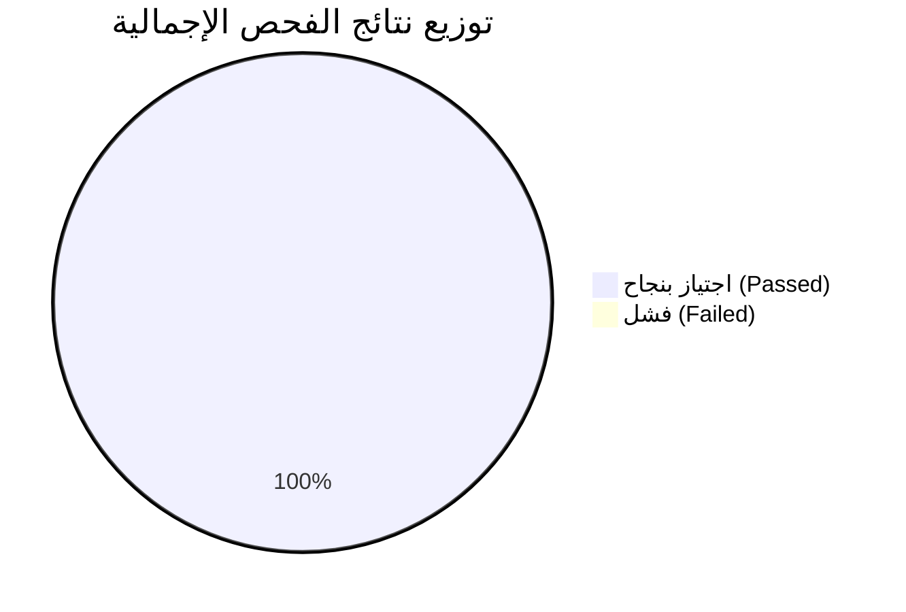

# تقرير أتمتة اختبارات الجودة الشامل (QA Test Automation Report)
**مشروع:** نظام فواتير وتحصيل المياه (NTS Billing Portal)  
**المنصة:** Oracle APEX  
**أداة الأتمتة ولغة البرمجة:** Playwright Framework | JavaScript (Node.js)  
**تاريخ التقرير:** 29 أكتوبر 2026  
**حالة الاختبارات الإجمالية:** ✅ **100% اجتياز (Passed)**

---

## 1. الملخص التنفيذي (Executive Summary)

تم تنفيذ وتطوير إطار عمل أتمتة متكامل لاختبارات الجودة (End-to-End Test Automation) لشاشات **إعدادات النظام (System Settings & Codings)** بنظام **NTS Billing**. 

جاء هذا المشروع كمبادرة نوعية تهدف إلى حل التحديات المتكررة عند نقل التحديثات بين بيئات العمل المختلفة (**Test ➔ Dev ➔ Production**)، وتحديداً لمعالجة مشكلة **نقص واختلاف قواعد التحقق من صحة البيانات (Missing Validations)**، وضمان سلامة البيانات قبل وصولها لبيئة التشغيل الفعلي.

### 📊 مؤشرات الأداء الرئيسية (KPIs):
* **عدد الشاشات المغطاة:** 45 شاشة / وحدة متكاملة.
* **إجمالي حالات الفحص المنفذة:** 135 سيناريو فحص مؤتمت (3 سيناريوهات معيارية لكل شاشة).
* **نسبة النجاح:** **100%** (جميع الاختبارات اجتازت بنجاح دون أي إخفاق).
* **التوثيق المرئي:** 135+ لقطة شاشة (Screenshot) ملتقطة آلياً توثق الأخطاء والنجاح والإلغاء.
* **متوسط وقت فحص الشاشة:** 18 - 25 ثانية فقط.



---

## 2. هيكلية سيناريوهات الفحص المعيارية لكل شاشة

لضمان تغطية شاملة ودقيقة لكل شاشة، تم تطبيق مصفوفة فحص موحدة ثلاثية المستويات:

| المعرف | اسم السيناريو | الهدف من الفحص | التوثيق المصور |
|---|---|---|---|
| **TC-01** | **فحص إلزامية الحقول والتحقق (Validation Check)** | ترك الحقول المطلوبة فارغة ومحاولة الحفظ للتحقق من ظهور رسائل التنبيه والمنع المناسبة (`APEX Error Alerts`). | `1_*_error.png` |
| **TC-02** | **إضافة/تعديل سجل صحيح (Valid Data Submission)** | إدخال بيانات صحيحة ومطابقة للشروط والتأكد من إتمام الحفظ وظهور الإشعار الأخضر (`تم حفظ البيانات بنجاح`). | `2_*_saved.png` |
| **TC-03** | **فحص الإلغاء وإغلاق النوافذ (Cancel & Modal Dismiss)** | فتح شاشة الإدخال، وكتابة بيانات مؤقتة، ثم الضغط على زر "إلغاء" للتحقق من سلامة إغلاق النافذة المنبثقة والـ iFrame. | `3_*_cancel_dialog.png` |

---

## 3. تفصيل الوحدات والشاشات المغطاة (Scope & Test Results)

### أولاً: وحدة تسجيل الدخول والأمان (Authentication)
* **الحالة:** ✅ مكتملة
* **الشاشات:**
  1. [apex-login.spec.js](file:///c:/Users/Yasmine/Desktop/nts/apex-login.spec.js): التحقق من صحة بيانات الدخول، منع الحقول الفارغة، اختيار التطبيق 100 بنجاح.

---

### ثانياً: وحدة ترميز التوزيع الجغرافي (Geographic Hierarchy)
* **الحالة:** ✅ مكتملة بنسبة 100%
* **الشاشات المغطاة:**
  1. [geo-coding.spec.js](file:///c:/Users/Yasmine/Desktop/nts/geo-coding.spec.js) - ترميز المحافظات
  2. [district-coding.spec.js](file:///c:/Users/Yasmine/Desktop/nts/district-coding.spec.js) - ترميز القضاء والمركز
  3. [area-coding.spec.js](file:///c:/Users/Yasmine/Desktop/nts/area-coding.spec.js) - ترميز المناطق
  4. [mahalla-coding.spec.js](file:///c:/Users/Yasmine/Desktop/nts/mahalla-coding.spec.js) - ترميز المحلات
  5. [alley-coding.spec.js](file:///c:/Users/Yasmine/Desktop/nts/alley-coding.spec.js) - ترميز الأزقة
  6. [house-coding.spec.js](file:///c:/Users/Yasmine/Desktop/nts/house-coding.spec.js) - ترميز الدار
  7. [house-type-coding.spec.js](file:///c:/Users/Yasmine/Desktop/nts/house-type-coding.spec.js) - ترميز أنواع الدار

---

### ثالثاً: وحدة ترميز الأصناف والعدادات (Items & Meters Coding)
* **الحالة:** ✅ مكتملة بنسبة 100%
* **الشاشات المغطاة:**
  8. [units-coding.spec.js](file:///c:/Users/Yasmine/Desktop/nts/units-coding.spec.js) - ترميز وحدات القياس
  9. [items-coding.spec.js](file:///c:/Users/Yasmine/Desktop/nts/items-coding.spec.js) - ترميز الأصناف
  10. [survey-diameters-coding.spec.js](file:///c:/Users/Yasmine/Desktop/nts/survey-diameters-coding.spec.js) - ترميز أقطار المقايسات
  11. [survey-diameter-items-coding.spec.js](file:///c:/Users/Yasmine/Desktop/nts/survey-diameter-items-coding.spec.js) - ترميز أصناف أقطار المقايسات
  12. [meter-types-coding.spec.js](file:///c:/Users/Yasmine/Desktop/nts/meter-types-coding.spec.js) - ترميز أنواع العدادات
  13. [meter-diameters-coding.spec.js](file:///c:/Users/Yasmine/Desktop/nts/meter-diameters-coding.spec.js) - ترميز أقطار العدادات
  14. [meter-locations-coding.spec.js](file:///c:/Users/Yasmine/Desktop/nts/meter-locations-coding.spec.js) - ترميز أماكن العدادات
  15. [meter-status-coding.spec.js](file:///c:/Users/Yasmine/Desktop/nts/meter-status-coding.spec.js) - ترميز حالات العدادات والمحاسبة
  16. [malfunctions-coding.spec.js](file:///c:/Users/Yasmine/Desktop/nts/malfunctions-coding.spec.js) - ترميز الأعطال

---

### رابعاً: وحدة ترميز الجباة وخطوط السير (Collectors & Route Lines)
* **الحالة:** ✅ مكتملة بنسبة 100%
* **الشاشات المغطاة:**
  17. [collectors-coding.spec.js](file:///c:/Users/Yasmine/Desktop/nts/collectors-coding.spec.js) - ترميز الجباة
  18. [route-lines-coding.spec.js](file:///c:/Users/Yasmine/Desktop/nts/route-lines-coding.spec.js) - ترميز خطوط السير
  19. [route-areas-coding.spec.js](file:///c:/Users/Yasmine/Desktop/nts/route-areas-coding.spec.js) - ترميز مناطق خطوط السير
  20. [collector-areas-coding.spec.js](file:///c:/Users/Yasmine/Desktop/nts/collector-areas-coding.spec.js) - توزيع الجباة على المناطق

---

### خامساً: وحدة ترميز الأسعار وحالات الحساب (Pricing & Accounts)
* **الحالة:** ✅ مكتملة بنسبة 100%
* **الشاشات المغطاة:**
  21. [subscription-types-coding.spec.js](file:///c:/Users/Yasmine/Desktop/nts/subscription-types-coding.spec.js) - أنواع الاشتراكات وشرائح الاستهلاك
  22. [customer-categories-coding.spec.js](file:///c:/Users/Yasmine/Desktop/nts/customer-categories-coding.spec.js) - ترميز فئات العملاء
  23. [account-statuses-coding.spec.js](file:///c:/Users/Yasmine/Desktop/nts/account-statuses-coding.spec.js) - ترميز حالات الحساب
  24. [sewage-status-coding.spec.js](file:///c:/Users/Yasmine/Desktop/nts/sewage-status-coding.spec.js) - ترميز حالات حساب الصرف الصحي
  25. [discrepancy-rates-coding.spec.js](file:///c:/Users/Yasmine/Desktop/nts/discrepancy-rates-coding.spec.js) - ترميز نسب المتناقضات
  26. [main-activities-coding.spec.js](file:///c:/Users/Yasmine/Desktop/nts/main-activities-coding.spec.js) - ترميز الأنشطة الرئيسية
  27. [sub-activities-coding.spec.js](file:///c:/Users/Yasmine/Desktop/nts/sub-activities-coding.spec.js) - ترميز الأنشطة الفرعية

---

### سادساً: وحدة ترميز الجباية وأمانة الصندوق (Cashier & Safes)
* **الحالة:** ✅ مكتملة بنسبة 100%
* **الشاشات المغطاة:**
  28. [safes-coding.spec.js](file:///c:/Users/Yasmine/Desktop/nts/safes-coding.spec.js) - ترميز الخزائن
  29. [banks-coding.spec.js](file:///c:/Users/Yasmine/Desktop/nts/banks-coding.spec.js) - ترميز البنوك
  30. [portfolios-coding.spec.js](file:///c:/Users/Yasmine/Desktop/nts/portfolios-coding.spec.js) - ترميز حافظات التوريد
  31. [portfolio-items-coding.spec.js](file:///c:/Users/Yasmine/Desktop/nts/portfolio-items-coding.spec.js) - ترميز بنود الحافظة
  32. [receipt-status-coding.spec.js](file:///c:/Users/Yasmine/Desktop/nts/receipt-status-coding.spec.js) - ترميز حالات إيصالات السداد

---

### سابعاً: وحدة ترميز خدمات الزبائن (Customer Services)
* **الحالة:** ✅ مكتملة بنسبة 100%
* **الشاشات المغطاة:**
  33. [complaint-types-coding.spec.js](file:///c:/Users/Yasmine/Desktop/nts/complaint-types-coding.spec.js) - ترميز أنواع الشكاوى
  34. [complaint-departments-coding.spec.js](file:///c:/Users/Yasmine/Desktop/nts/complaint-departments-coding.spec.js) - ترميز إدارات الشكاوى
  35. [document-types-coding.spec.js](file:///c:/Users/Yasmine/Desktop/nts/document-types-coding.spec.js) - ترميز أنواع المستندات
  36. [requests-coding.spec.js](file:///c:/Users/Yasmine/Desktop/nts/requests-coding.spec.js) - ترميز الطلبات
  37. [request-steps-coding.spec.js](file:///c:/Users/Yasmine/Desktop/nts/request-steps-coding.spec.js) - ترميز خطوات الطلب
  38. [request-steps-link-coding.spec.js](file:///c:/Users/Yasmine/Desktop/nts/request-steps-link-coding.spec.js) - ربط الطلبات بالخطوات
  39. [meter-replacement-reasons-coding.spec.js](file:///c:/Users/Yasmine/Desktop/nts/meter-replacement-reasons-coding.spec.js) - ترميز أسباب استبدال العداد
  40. [notification-settings.spec.js](file:///c:/Users/Yasmine/Desktop/nts/notification-settings.spec.js) - إعدادات الإشعارات

---

### ثامناً: وحدة ترميز الخدمات المالية (Financial Services)
* **الحالة:** ✅ مكتملة بنسبة 100%
* **الشاشات المغطاة:**
  41. [scheduling-installment-types-coding.spec.js](file:///c:/Users/Yasmine/Desktop/nts/scheduling-installment-types-coding.spec.js) - ترميز أنواع أقساط الجدولة
  42. [additional-services-coding.spec.js](file:///c:/Users/Yasmine/Desktop/nts/additional-services-coding.spec.js) - ترميز الخدمات المضافة

---

### تاسعاً: وحدة إعدادات التشغيل الأساسية (Operational Settings)
* **الحالة:** ✅ مكتملة بنسبة 100%
* **الشاشات المغطاة:**
  43. [operational-settings-coding.spec.js](file:///c:/Users/Yasmine/Desktop/nts/operational-settings-coding.spec.js) - إعدادات التشغيل
  44. [release-steps-coding.spec.js](file:///c:/Users/Yasmine/Desktop/nts/release-steps-coding.spec.js) - خطوات تشغيل الإصدار

---

## 4. النتائج والتوصيات المكتشفة أثناء الفحص

1. **التعامل مع القيود اللغوية المخصصة:**
   - كشف الفحص الآلي أن شاشة *ترميز أسباب استبدال العداد* تفرض قيوداً دقيقة تمنع الأرقام في حقول الأسماء وتتطلب أحرفاً عربية وإنجليزية حصرية.
2. **قواعد منع التكرار (Unique Constraints):**
   - تم التحقق من سلامة قواعد منع التكرار في شاشات مثل *ترميز الخزائن* (خزينة واحدة لكل قضاء) و*ترميز بنود الحافظة* (منع تكرار عناصر الفاتورة).
3. **الجداول التفاعلية والمزامنة (Master-Detail Grids):**
   - أثبتت الاختبارات كفاءة مزامنة القوائم المنسدلة مع الجداول التفاعلية في شاشات *ربط الطلبات بالخطوات* و*شرائح الاستهلاك*.

---

## 5. مخرجات المشروع ومسار المراجعة

* **المستودع الرئيسي على GitHub:** [YasminHamdy1993/NTS](https://github.com/YasminHamdy1993/NTS)
* **ملف التوثيق الفني:** [README.md](file:///c:/Users/Yasmine/Desktop/nts/README.md)
* **أمر التشغيل السريع لتقرير HTML:**
  ```powershell
  npx.cmd playwright test
  npx.cmd playwright show-report
  ```
